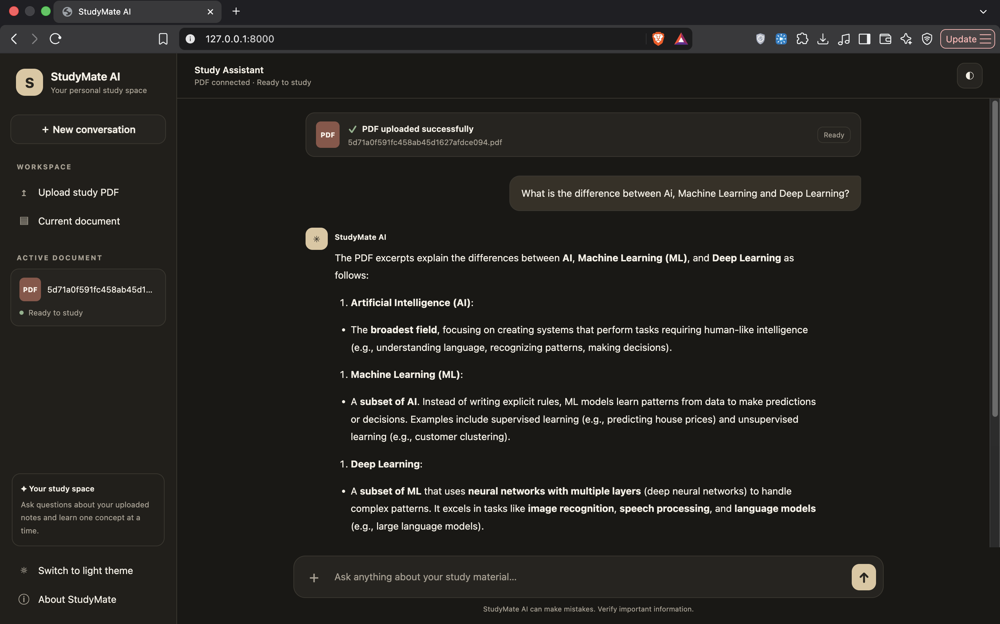

## 📸 Project Screenshots

### StudyMate AI Home Page


### AI Chat Response

# StudyMate AI — PDF RAG Teaching Assistant

A locally running AI teaching assistant that answers questions using information retrieved from your uploaded PDF documents. Built with Python, FastAPI, LangChain, ChromaDB, Hugging Face embeddings, and Ollama.

## Features

- **PDF Upload:** Upload PDF study materials through a web interface.
- **Retrieval-Augmented Generation (RAG):** Split documents into text chunks and retrieve relevant content using vector similarity search.
- **Local AI Inference:** Generate answers using Ollama without requiring a paid LLM API.
- **Document Isolation:** Select a PDF and retrieve information from that document.
- **Source References:** Display source document names and page references with answers.
- **Conversation History:** Maintain recent chat context for follow-up questions.
- **REST API:** Access document processing and question-answering functionality through FastAPI.
- **Automated Tests:** Test API endpoints, PDF-processing behavior, and error handling.

## Tech Stack

| Technology | Purpose |
|---|---|
| Python | Core application |
| FastAPI | Backend REST API |
| LangChain | Document processing and RAG workflow |
| ChromaDB | Vector storage and similarity search |
| Hugging Face | Text embedding generation |
| Ollama | Local language model inference |
| HTML, CSS, JavaScript | Frontend interface |
| Pytest | Automated testing |

## Project Structure

```text
rag_project/
├── app/
│   ├── config.py
│   └── main.py
├── services/
│   └── rag_service.py
├── frontend/
│   └── index.html
├── data/
│   └── uploads/
├── chroma_db/
├── tests/
│   └── test_main.py
├── requirements.txt
├── README.md
└── .gitignore
```

## Prerequisites

- Python 3.11 or a compatible Python version supported by your installed dependencies
- [Ollama](https://ollama.com/)
- Git (for cloning the repository)

Internet access is needed to download Python packages, the Ollama model, and the embedding model for the first time.

## Installation and Setup

### 1. Clone the repository

```bash
git clone YOUR_GITHUB_REPOSITORY_URL
cd rag_project
```

Replace `YOUR_GITHUB_REPOSITORY_URL` with your actual repository URL.

### 2. Create and activate a virtual environment

```bash
python3 -m venv .venv
source .venv/bin/activate
```

### 3. Install dependencies

```bash
python -m pip install --upgrade pip
python -m pip install -r requirements.txt
```

### 4. Install and prepare Ollama

Install Ollama from https://ollama.com/ and ensure it is running.

Download the configured language model:

```bash
ollama pull qwen3:8b
```

The default model is `qwen3:8b`. You can configure another installed Ollama model using the `OLLAMA_MODEL` environment variable.

### 5. Start the application

From the project root, run:

```bash
python -m uvicorn app.main:app --reload
```

Open the following URLs in your browser:

- **Web interface:** http://127.0.0.1:8000/
- **Interactive API documentation:** http://127.0.0.1:8000/docs
- **Health check:** http://127.0.0.1:8000/health

## API Endpoints

| Method | Endpoint | Description |
|---|---|---|
| GET | `/` | Serves the web interface |
| GET | `/health` | Checks application health |
| GET | `/documents` | Lists uploaded PDF files |
| POST | `/upload` | Uploads and indexes a PDF |
| POST | `/ask` | Answers a question using the selected PDF |

Use the interactive API documentation at `/docs` to explore request formats and responses.

## Running Tests

Activate your virtual environment and run:

```bash
python -m pytest -v
```

The current test suite covers API health, homepage loading, invalid uploads, PDF-processing behavior, empty documents, and invalid question requests.

## How It Works

1. The user uploads a PDF.
2. The backend extracts its text and divides it into smaller chunks.
3. Hugging Face embeddings convert the chunks into vectors.
4. ChromaDB stores the vectors and associated document metadata.
5. When a question is submitted, relevant chunks are retrieved from the selected PDF.
6. Ollama generates an answer using the retrieved document content.
7. The interface displays the answer and source-page references.

## Privacy and Cost

- Language-model inference runs locally through Ollama.
- No paid LLM API key is required by the default workflow.
- Uploaded documents and the ChromaDB index are stored locally by default.
- Initial package and model downloads require internet access.

## Future Improvements

- Improve retrieval relevance and answer-grounding evaluation.
- Add document deletion and index-management features.
- Add more comprehensive integration tests.
- Improve handling of scanned PDFs and OCR.
- Add deployment configuration and authentication where needed.

## Author

Developed as an AI/ML and backend development project to explore Retrieval-Augmented Generation, vector databases, local language models, and REST API development.
